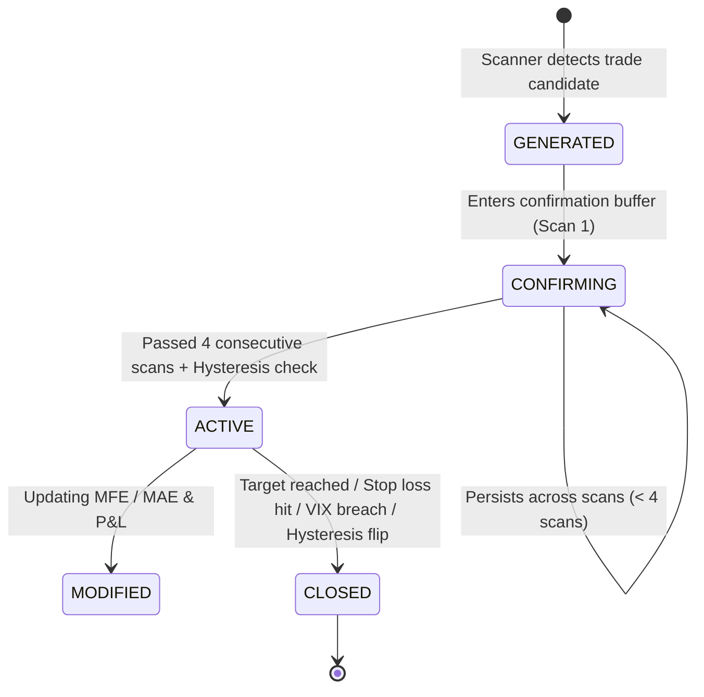

# AI Trade Recommendation Engine — Architectural Logic & Calculation Specification

This document provides an exhaustive, mathematical, and algorithmic specification of the **AI Trade Recommendation Engine** and the accompanying **Signal Lifecycle & Hysteresis Engine** in the NSE F&O Institutional Dashboard.

---

## 1. Executive Summary & Purpose

The **AI Trade Recommendation Engine** is an institutional decision-support system designed explicitly for option sellers (short premium traders). Unlike retail systems that recommend high-risk direction-buying options, this engine prioritizes high-probability theta decay, institutional open interest defense, strict risk-defined margin allocation, and noise-filtered signal stability.

### Primary Operational Modules:
1. **Multi-Factor Trade Scorer (`TradeScorer`)**: Evaluates every option strike across an 8-factor, 100-point quantitative scoring matrix.
2. **Option Seller Strategy Engine (`SellerEngine`)**: Constructs optimal short single options, short strangles, short straddles, and 4-leg Iron Condors under symbol-specific delta/margin constraints.
3. **Safety Circuit Breakers & Guards**: Enforces strict India VIX thresholds ($\text{VIX} \le 22.0$) and market-hours validations.
4. **Signal Lifecycle & Hysteresis Engine (`SignalLifecycleEngine`)**: Eliminates tick-level signal noise using confirmation buffers, score hysteresis thresholds, minimum holding periods, and real-time MFE/MAE tracking.

---

## 2. Multi-Factor Scoring Model (100-Point Scale)

The `TradeScorer` class (`backend/app/engines/trade_scorer.py`) evaluates candidates across **8 weighted factors** totaling 100 points:

$$\text{Total Score} = S_{\text{momentum}} + S_{\text{volume}} + S_{\text{oi}} + S_{\text{pcr}} + S_{\text{iv}} + S_{\text{sector}} + S_{\text{trend}} + S_{\text{risk}}$$

| Scoring Factor | Max Points | Evaluation Weight | Primary Indicator Evaluated |
| :--- | :---: | :---: | :--- |
| **1. Momentum / Distance** | 20 | 20% | Distance from current spot price |
| **2. Liquidity / Volume** | 15 | 15% | Relative option volume vs max volume |
| **3. Open Interest (OI)** | 20 | 20% | Total OI base + OI buildup bonus |
| **4. PCR Alignment** | 10 | 10% | PCR direction suitability |
| **5. Implied Volatility (IV)** | 10 | 10% | IV sweet-spot vs expansion risk |
| **6. Sector Confirmation** | 10 | 10% | Underlying sector breadth trend |
| **7. Trend / OI Build** | 10 | 10% | OI interpretation classification |
| **8. Gamma Risk** | 5 | 5% | Gamma Greek magnitude |
| **TOTAL** | **100** | **100%** | **Composite Recommendation Score** |

---

### 2.1. Mathematical Formulas per Scoring Factor

#### 1. Momentum Score ($S_{\text{momentum}}$, Max: 20 pts)
Measures safety buffer (distance of strike from spot price). Further strikes provide wider margin for error:

$$\text{Distance \%} = \frac{|\text{Strike Price} - \text{Spot Price}|}{\text{Spot Price}} \times 100$$

$$S_{\text{momentum}} = \min\left(20.0, \, \text{Distance \%} \times 4.0\right)$$

---

#### 2. Volume / Liquidity Score ($S_{\text{volume}}$, Max: 15 pts)
Ensures execution liquidity and tight bid-ask spreads by scoring volume relative to the maximum volume observed across all option chain strikes:

$$S_{\text{volume}} = \begin{cases} 
\frac{\text{Volume}_{\text{strike}}}{\text{Max Volume in Chain}} \times 15.0, & \text{if } \text{Max Volume} > 0 \\ 
\min\left(15.0, \frac{\text{Volume}_{\text{strike}}}{100,000} \times 15.0\right), & \text{otherwise} 
\end{cases}$$

---

#### 3. Open Interest Defense Score ($S_{\text{oi}}$, Max: 20 pts)
Higher Open Interest indicates institutional commitment to defend a strike level.

$$S_{\text{base\_oi}} = \begin{cases} 
\frac{\text{OI}_{\text{strike}}}{\text{Max OI in Chain}} \times 15.0, & \text{if } \text{Max OI} > 0 \\ 
10.0, & \text{otherwise} 
\end{cases}$$

$$S_{\text{oi}} = \begin{cases} 
\min\left(20.0, \, S_{\text{base\_oi}} + 5.0\right), & \text{if } \Delta\text{OI}_{\text{strike}} > 0 \text{ (Fresh buildup)} \\ 
S_{\text{base\_oi}}, & \text{otherwise} 
\end{cases}$$

---

#### 4. PCR Alignment Score ($S_{\text{pcr}}$, Max: 10 pts)
Aligns option type selection with overall market Put-Call Ratio (PCR):

$$S_{\text{pcr}} = \begin{cases} 
\min\left(10.0, \, (\text{PCR} - 0.5) \times 10.0\right), & \text{for CE selling when } \text{PCR} > 1.0 \\ 
\min\left(10.0, \, (1.5 - \text{PCR}) \times 10.0\right), & \text{for PE selling when } \text{PCR} < 1.0 \\ 
5.0, & \text{otherwise (Neutral market)} 
\end{cases}$$

---

#### 5. Implied Volatility Score ($S_{\text{iv}}$, Max: 10 pts)
Sellers profit from high IV, but extreme IV ($>50\%$) signals impending market shock and extreme gamma risk:

$$S_{\text{iv}} = \begin{cases} 
10.0, & \text{if } 15\% \le \text{IV} \le 30\% \text{ (Optimal premium zone)} \\ 
7.0, & \text{if } 30\% < \text{IV} \le 50\% \text{ (Elevated premium)} \\ 
3.0, & \text{if } \text{IV} > 50\% \text{ (High IV expansion risk)} \\ 
5.0, & \text{if } \text{IV} < 15\% \text{ (Low premium available)} 
\end{cases}$$

---

#### 6. Sector Strength Score ($S_{\text{sector}}$, Max: 10 pts)
Aligns recommendations with sector flow (e.g., selling Call options when the index's core sector is bearish):

$$S_{\text{sector}} = \begin{cases} 
10.0, & \text{for CE selling if Sector Bearish \%} > 60\% \\ 
10.0, & \text{for PE selling if Sector Bullish \%} > 60\% \\ 
5.0, & \text{otherwise} 
\end{cases}$$

---

#### 7. Trend & OI Interpretation Score ($S_{\text{trend}}$, Max: 10 pts)
Derived from price change and OI change classification:

| OI Interpretation | CE Selling Score | PE Selling Score |
| :--- | :---: | :---: |
| **Fresh Short** | **10 pts** (Best) | 7 pts |
| **Fresh Long** | 7 pts | **10 pts** (Best) |
| **Short Covering** | 4 pts | 6 pts |
| **Long Unwinding** | 6 pts | 4 pts |
| **No Change** | 5 pts | 5 pts |

---

#### 8. Gamma Risk Score ($S_{\text{risk}}$, Max: 5 pts)
Low absolute gamma prevents sharp adverse price spikes:

$$S_{\text{risk}} = \begin{cases} 
5.0, & \text{if } |\gamma| < 0.0003 \text{ (Very low gamma risk)} \\ 
3.0, & \text{if } 0.0003 \le |\gamma| < 0.0008 \text{ (Moderate gamma risk)} \\ 
1.0, & \text{if } |\gamma| \ge 0.0008 \text{ (High gamma risk)} 
\end{cases}$$

---

### 2.2. Composite Recommendation Output Thresholds

The composite score determines the formal recommendation label and minimum quality filter:

```
[ Total Score >= 75 ]  -->  STRONG SELL  (High conviction institutional trade)
[ 60 <= Score < 75 ]   -->  SELL         (Standard institutional trade)
[ Total Score < 60  ]  -->  AVOID        (Suppressed / Low confluence, avoided)
```

---

## 3. Strategy Generation Engine (`SellerEngine`)

The `SellerEngine` (`backend/app/engines/seller_engine.py`) scans option chain strikes to build four distinct option-selling strategy structures.

### 3.1. Symbol-Specific Execution Parameters & Lot Sizes

| Symbol | Lot Size | Max Allowed Distance from ATM | Min Recommended Premium | Fallback Premium |
| :--- | :---: | :---: | :---: | :---: |
| **NIFTY** | 75 | 150 pts (~3 strikes) | ₹ 28.00 | ₹ 15.00 |
| **BANKNIFTY** | 30 | 300 pts (~3 strikes) | ₹ 50.00 | ₹ 30.00 |
| **FINNIFTY** | 40 | 150 pts | ₹ 30.00 | ₹ 15.00 |
| **MIDCPNIFTY** | 50 | 75 pts | ₹ 20.00 | ₹ 10.00 |

---

### 3.2. Market Direction Filter & Short-Term Momentum Rule

Before recommending option selling candidates, the engine checks short-term underlying price action momentum (`pctChange`):

* **Bullish Momentum (`pctChange > +0.20%`)**:
  * **CE Selling**: Penalized by **-18.0 to -25.0 points** (or suppressed if `pctChange > 0.40%`) to prevent fighting upward breakouts.
  * **PE Selling**: Boosted by **+5.0 points**.
* **Bearish Momentum (`pctChange < -0.20%`)**:
  * **PE Selling**: Penalized by **-18.0 to -25.0 points** (or suppressed if `pctChange < -0.40%`) to prevent catching falling knives.
  * **CE Selling**: Boosted by **+5.0 points**.

---

### 3.3. Smart Money Tracker Integration & Wall Alignment Matrix

Confluence scoring is dynamically adjusted based on active Smart Money Tracker metrics and institutional wall positioning:

1. **Strong Wall Defense Alignment (+14 pts)**:
   * **CE Candidates**: Awarded **+14 pts** when the strike is at or near the `call_wall_strike` ($\le 100$ pts from Call Resistance Wall).
   * **PE Candidates**: Awarded **+14 pts** when the strike is at or near the `put_wall_strike` ($\le 100$ pts from Put Defense Floor).
2. **Far-Wall Penalty (-12 pts)**:
   * **CE Candidates**: Penalized by **-12 pts** if strike is $>150$ pts above Call Resistance Wall (unprotected OTM premium without wall defense).
   * **PE Candidates**: Penalized by **-12 pts** if strike is $>150$ pts below Put Defense Floor (unprotected OTM premium without wall defense).
3. **High Conviction Boost (+5 pts)**:
   * Awarded when `call_conviction >= 70%` (for CE) or `put_conviction >= 70%` (for PE).
4. **Net Institutional Bias Alignment & Range-Bound Single-Leg Penalty**:
   * If `net_bias == "BULLISH FLOOR BUILDING"`: CE sell penalized by **-12 pts**, PE sell boosted by **+5 pts**.
   * If `net_bias == "BEARISH CEILING BUILDING"`: PE sell penalized by **-12 pts**, CE sell boosted by **+5 pts**.
   * If `net_bias == "RANGE-BOUND ACCUMULATION"`: Naked CE sell penalized by **-15 pts**, Naked PE sell penalized by **-10 pts**.
5. **Range-Bound Multi-Leg Strategy Prioritization (+15 pts)**:
   * In range-bound markets, **Short Strangle** and **Iron Condor** receive a **+15.0 pts** confidence boost and are prioritized as `#1 Top Recommendation`.
6. **Institutional OI Block Trades (+8 pts)**:
   * Fresh OI shifts $\ge 40,000$ contracts at candidate strike award an extra **+8 pts** boost.

---

### 3.4. Single Option Selling (Sell CE / Sell PE)

* **Candidate Filtering**: Selects strikes within symbol-specific ATM bounds with active OI ($>0$) and actionable premium ($\ge \text{min\_premium}$).
* **Probability of Profit (POP)**: Derived using Delta ($\Delta$) as an empirical probability proxy:
  $$\text{POP} = \text{round}\left((1 - |\Delta|) \times 100, \, 1\right)$$
* **Suggested Stop Loss**: Fixed at $2.0 \times \text{Entry Premium}$ (risk/reward capped at 1:1 risk vs premium collected).
* **Margin Approximation**:
  $$\text{Margin Required} = \text{round}\left(\text{Spot Price} \times \text{Lot Size} \times 0.12, \, 0\right) \quad (\approx 12\% \text{ SPAN margin})$$

---

### 3.5. Short Strangle Construction

Combines the safest CE recommendation above resistance and safest PE recommendation below support:

$$\text{Total Premium} = \text{Premium}_{\text{CE}} + \text{Premium}_{\text{PE}}$$

$$\text{POP}_{\text{Strangle}} = \max\left(0.0, \, \text{POP}_{\text{CE}} + \text{POP}_{\text{PE}} - 100.0\right)$$

> **Mathematical Integrity Note**: Strangle POP measures the joint probability that **both** legs expire Out-Of-The-Money (OTM), calculated as $P(A \cap B) = P(A) + P(B) - 1$ assuming near-independence at outer wings.

$$\text{Margin Required} = \text{round}\left(\text{Spot Price} \times \text{Lot Size} \times 0.15, \, 0\right) \quad (\approx 15\% \text{ SPAN margin})$$

---

### 3.6. Short Straddle Construction (ATM)

Sells exact ATM Call and ATM Put simultaneously to capture maximum extrinsic decay:

$$\text{Total Premium} = \text{LTP}_{\text{CE}}(\text{ATM}) + \text{LTP}_{\text{PE}}(\text{ATM})$$

$$\text{Breakeven Range \%} = \frac{\text{Total Premium}}{\text{Spot Price}} \times 100$$

$$\text{Daily Volatility} = \frac{\text{Average IV}}{100 \times \sqrt{252}}$$

$$\text{Standard Score } Z = \frac{\text{Breakeven Range \%}}{100 \times \text{Daily Volatility}}$$

$$\text{POP}_{\text{Straddle}} = \text{clamp}_{20.0}^{75.0} \left( \left( 2 \cdot \Phi(Z) - 1 \right) \times 100 \right)$$

where $\Phi(Z) = \frac{1}{2} \left[ 1 + \text{erf}\left(\frac{Z}{\sqrt{2}}\right) \right]$ is the standard normal cumulative distribution function (CDF).

---

### 3.7. Iron Condor (4-Leg Defined Risk)

Builds a 4-leg hedged spread using Support ($S_1$) and Resistance ($R_1$) levels:

1. **Sell PE** at $S_1$ (Sell Bull Put leg)
2. **Buy PE** at $S_1 - \text{Step}$ (Buy Put Hedge Protection)
3. **Sell CE** at $R_1$ (Sell Bear Call leg)
4. **Buy CE** at $R_1 + \text{Step}$ (Buy Call Hedge Protection)

* **Net Premium Collected**:
  $$\text{Net Credit} = (\text{LTP}_{\text{Sell CE}} - \text{LTP}_{\text{Buy CE}}) + (\text{LTP}_{\text{Sell PE}} - \text{LTP}_{\text{Buy PE}})$$
* **Max Risk Cap**:
  $$\text{Max Risk per Lot} = (\text{Strike Step} - \text{Net Credit}) \times \text{Lot Size}$$
* **Margin Required**:
  $$\text{Margin} = \text{Strike Step} \times \text{Lot Size}$$

---

## 4. Safety Circuit Breakers & Market Hours Guards

To shield option sellers from catastrophic tail risk, the engine enforces strict circuit breakers:

### 4.1. India VIX Circuit Breaker ($\text{VIX} > 22.0$)
When India VIX exceeds **22.0**, option selling becomes dangerously exposed to gamma explosions and overnight gap risk.

```python
if vix.current > 22.0:
    return [SellerRecommendation(
        strategy="MARKET ALERT: VIX TOO HIGH",
        total_premium=0,
        probability_of_profit=0,
        risk_level="avoid",
        confidence=0,
        reasoning=[
            f"VIX at {vix.current:.1f} exceeds safety threshold of 22.0",
            "Option selling carries extreme gamma/gap risk in high-VIX environments",
            "Wait for VIX to settle below 20 before initiating short premium positions"
        ]
    )]
```

### 4.2. Market Hours Guard
Validates current system time against NSE trading hours ($09:15$ to $15:30$ IST). If market is closed, a warning tag `⚠ MARKET CLOSED — data may be stale` is appended to all trade reasonings.

---

## 5. Institutional Signal Lifecycle & Hysteresis Engine

To prevent tick noise from causing frequent "signal flips" or trade over-churning, incoming trade recommendations pass through `SignalLifecycleEngine` (`backend/app/engines/signal_lifecycle.py`).

### 5.1. Signal State Machine



---

### 5.2. Noise-Filtering Mechanisms

#### A. Confirmation Buffer ($\ge 4$ Consecutive Scans)
A candidate strategy must remain unchanged and valid across **4 consecutive market scans** before it can be promoted from `CONFIRMING` to `ACTIVE`.

#### B. Hysteresis Threshold Guard ($+18.0$ Points Margin)
If an active position exists for a symbol, a new candidate strategy can only replace the active signal if its confidence score beats the active score by at least **+18.0 points**:

$$\text{Candidate Confidence} \ge \text{Active Confidence} + 18.0$$

#### C. Minimum Holding Period Guard ($450$ Seconds / 7.5 Minutes)
Prevents active signals from being terminated or switched within **450 seconds** of entry, protecting position stability against transient intraday tick spikes.

---

### 5.3. Real-Time MFE & MAE Tracking

For every active position, the engine updates unrealized P&L, **Max Favorable Excursion (MFE)**, and **Max Adverse Excursion (MAE)** on every price tick:

$$\text{Unrealized P\&L (pts)} = \text{Entry Premium} - \text{Current Premium}$$

$$\text{MFE}_{\text{pts}} = \max\left(\text{MFE}_{\text{pts}}, \, \text{Unrealized P\&L}\right)$$

$$\text{MAE}_{\text{pts}} = \min\left(\text{MAE}_{\text{pts}}, \, \text{Unrealized P\&L}\right) \quad (\text{Drawdown is negative})$$

---

### 5.4. Signal Closing & Invalidation Criteria

An active signal is immediately transitioned to `CLOSED` status under any of the following conditions:

1. **Target Reached**: $\text{Current Premium} \le 0.20 \times \text{Entry Premium}$ ($80\%$ theta decay captured).
2. **Stop Loss Hit**: $\text{Current Premium} \ge \text{Suggested Stop Loss}$ ($200\%$ premium expansion).
3. **VIX Circuit Breaker Breach**: $\text{India VIX} > 22.0$.
4. **Hysteresis Replacement**: Promoted candidate passed confirmation buffer and beat active score by $\ge +15.0$ points.

Upon closing, realized metrics are computed:

$$\text{Realized P\&L (₹)} = (\text{Entry Premium} - \text{Exit Premium}) \times \text{Lot Size}$$

$$\text{Realized ROI \%} = \frac{\text{Realized P\&L (₹)}}{\text{Margin Required}} \times 100$$

---

## 6. Institutional Performance Analytics

The system aggregates quantitative metrics across all closed signals to output institutional performance analytics:

* **Win Rate \%**: $\frac{\text{Number of Winning Trades}}{\text{Total Closed Trades}} \times 100$
* **Profit Factor**: $\frac{\sum \text{Gross Realized Profits}}{\sum |\text{Gross Realized Losses}|}$
* **Factor Attribution**: Relative breakdown of P&L contribution across scoring components (e.g., **OI Defense: 45%**, **Theta Decay: 30%**, **S/R Bounce: 25%**).
* **Tiered Accuracy**: Separates accuracy for High Confidence ($\ge 70\%$) vs Medium Confidence ($40\% - 69\%$) signals.
