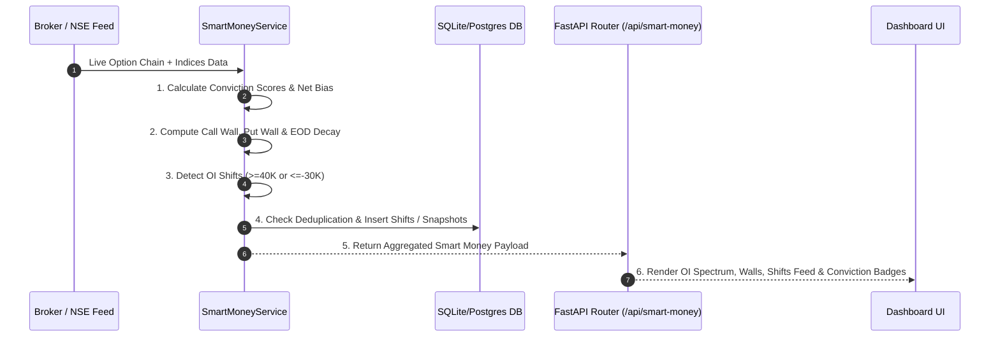

# Smart Money Tracker — Architectural Logic & Calculation Specification

This document provides a comprehensive, mathematical, and architectural breakdown of the **Smart Money Tracker** module within the NSE F&O Institutional Dashboard.

---

## 1. Executive Summary & Purpose

The **Smart Money Tracker** is an institutional-grade analytics engine designed to identify, quantify, and track large-scale institutional position building ("Smart Money") in near-real-time across NSE derivatives (NIFTY, BANKNIFTY, FINNIFTY, MIDCPNIFTY).

### Key Responsibilities:
1. **Institutional OI Shift Detection**: Identifies block trades, massive option writing additions ($\ge 40,000$ contracts), and large unwinding positions ($\le -30,000$ contracts).
2. **Conviction Metrics Calculation**: Computes quantitative 0–100% scores for **Call Writing Conviction** (Resistance Floor/Ceiling) and **Put Writing Conviction** (Bullish Support Floor).
3. **Institutional Wall Detection**: Dynamically locates the primary **Call Wall** (max Call Open Interest) and **Put Wall** (max Put Open Interest).
4. **Decay Estimation**: Estimates expected premium decay by End-of-Day (EOD) based on ATM option pricing structure.
5. **Persistence & Historical Analytics**: Persists all detected shifts and daily market snapshots into an ACID-compliant database (SQLite/PostgreSQL) with full historical date query capabilities.

---

## 2. Quantitative Formulas & Calculation Engine

All calculations are executed in real-time by `SmartMoneyService` (`backend/app/services/smart_money_service.py`) upon receiving raw or parsed Option Chain feeds.

### 2.1. Put Writing Conviction (Bullish Floor Score)

Put Writing Conviction quantifies the strength of institutional put writers defending lower levels (creating a price floor).

$$\text{Put Conviction} = \text{clamp}_{20.0}^{99.0} \left( \text{round}\left( \frac{\text{Total PE OI}}{\max(1, \text{Total CE OI})} \times 50.0 + \frac{\text{Total PE OI Change}}{100,000.0}, 1 \right) \right)$$

#### Component Breakdown:
* **Base Ratio Component**: $\frac{\text{Total PE OI}}{\text{Total CE OI}} \times 50.0$ establishes the baseline dominance of Put OI over Call OI.
* **Buildup Velocity Bonus**: $\frac{\text{Total PE OI Change}}{100,000.0}$ adds points for fresh intraday put writing (1 point per 100,000 contracts added).
* **Clamping Limits**: Bounded strictly between **20.0%** (minimum baseline floor) and **99.0%** (maximum institutional ceiling).

---

### 2.2. Call Writing Conviction (Bearish Ceiling Score)

Call Writing Conviction quantifies the aggressiveness of call writers creating resistance ceilings overhead.

$$\text{Call Conviction} = \text{clamp}_{20.0}^{99.0} \left( \text{round}\left( \frac{\text{Total CE OI}}{\max(1, \text{Total PE OI})} \times 50.0 + \frac{\text{Total CE OI Change}}{100,000.0}, 1 \right) \right)$$

#### Component Breakdown:
* **Base Ratio Component**: $\frac{\text{Total CE OI}}{\text{Total PE OI}} \times 50.0$ establishes baseline Call OI dominance.
* **Buildup Velocity Bonus**: $\frac{\text{Total CE OI Change}}{100,000.0}$ rewards aggressive call writing additions.
* **Clamping Limits**: Bounded between **20.0%** and **99.0%**.

---

### 2.3. Net Institutional Bias Classification

The system evaluates the ratio of aggregate Put OI Change vs Call OI Change across all strikes to determine overall institutional posture:

$$\text{Net Institutional Bias} = \begin{cases} 
\text{"BULLISH FLOOR BUILDING"}, & \text{if } \text{Total PE OI Change} > 1.3 \times \text{Total CE OI Change} \\ 
\text{"BEARISH CEILING BUILDING"}, & \text{if } \text{Total CE OI Change} > 1.3 \times \text{Total PE OI Change} \\ 
\text{"RANGE-BOUND ACCUMULATION"}, & \text{otherwise} 
\end{cases}$$

---

### 2.4. Call Wall & Put Wall Strike Identification

Institutional walls act as major support and resistance zones where institutional option writers hold maximum delta exposure:

$$\text{Call Wall Strike} = \arg\max_{s \in \text{Strikes}, s \ge \text{ATM}} (\text{CE OI}_s)$$

$$\text{Put Wall Strike} = \arg\max_{s \in \text{Strikes}, s \le \text{ATM}} (\text{PE OI}_s)$$

> **Logical Floor & Ceiling Rule**:
> * **Call Wall (Ceiling)**: Constrained strictly to strikes **at or above ATM Strike** ($s \ge \text{ATM}$) to represent true resistance overhead.
> * **Put Wall (Support Floor)**: Constrained strictly to strikes **at or below ATM Strike** ($s \le \text{ATM}$) to represent true price floor defense.
* **Fallback Bounds**:
  * $\text{Call Wall Fallback} = \text{ATM Strike} + \text{Default Step}$ (300 pts for Banknifty, 150 pts for Nifty)
  * $\text{Put Wall Fallback} = \text{ATM Strike} - \text{Default Step}$

---

### 2.5. Expected EOD Premium Decay Calculation

The expected intraday theta decay for ATM straddles/strangles is computed using the combined ATM premium:

$$\text{ATM Premium} = \text{LTP}_{\text{CE}}(\text{ATM}) + \text{LTP}_{\text{PE}}(\text{ATM})$$

$$\text{Expected Decay} = \text{round}\left( \text{ATM Premium} \times 0.45, 2 \right)$$

> **Trading Insight**: Empirically, ATM options on standard non-expiry trading days lose approximately 40–50% of their extrinsic value during normal market hours ($09:15$ to $15:30$ IST).

---

## 3. Institutional Shift Detection Rules & Symbol-Specific Thresholds

`SmartMoneyService.process_and_persist()` scans every individual strike row in the active option chain against symbol-calibrated volume & OI thresholds:

### 3.1. Symbol-Specific Detection Thresholds

| Symbol | Min OI Shift Addition Threshold | Min Unwinding Threshold | Default Step Width |
| :--- | :---: | :---: | :---: |
| **NIFTY** | $\ge +35,000$ contracts | $\le -25,000$ contracts | 150 pts |
| **BANKNIFTY** | $\ge +25,000$ contracts | $\le -20,000$ contracts | 300 pts |
| **FINNIFTY** | $\ge +20,000$ contracts | $\le -15,000$ contracts | 150 pts |
| **MIDCPNIFTY** | $\ge +15,000$ contracts | $\le -10,000$ contracts | 75 pts |

### 3.2. Shift Event Log Rules

| Trigger Condition | Classification | Shift Type | Shift Description Format |
| :--- | :--- | :--- | :--- |
| $\Delta \text{PE OI}_s \ge \text{Threshold}$ | Put Addition | `BULL` | `Smart Money added +{X}L PE OI at {Strike} PE (Strong Floor)` |
| $\Delta \text{CE OI}_s \ge \text{Threshold}$ | Call Addition | `BEAR` | `Smart Money added +{X}L CE OI at {Strike} CE (Resistance Ceiling)` |
| $\Delta \text{CE OI}_s \le \text{Unwind Threshold}$ | Call Unwinding | `BULL` | `Call Unwinding observed at {Strike} CE ({K} OI)` |
| $\Delta \text{PE OI}_s \le \text{Unwind Threshold}$ | Put Unwinding | `BEAR` | `Put Unwinding observed at {Strike} PE ({K} OI)` |

---

## 4. Visual OI Spectrum & Top Distribution Algorithm

### 4.1. Centered 11-Strike OI Spectrum Chart

To guarantee symmetry on the dashboard visualizer, the service selects an exact 11-strike spectrum centered at the At-The-Money (ATM) strike:

1. Locate exact ATM strike index $i_{\text{ATM}}$ in the sorted strike list.
2. Select line range from $\max(0, i_{\text{ATM}} - 5)$ to $\min(N, i_{\text{ATM}} + 6)$.
3. Returns exactly **5 strikes below ATM**, **1 ATM strike**, and **5 strikes above ATM**.

```
[ Strike -250 ] [ Strike -200 ] [ Strike -150 ] [ Strike -100 ] [ Strike -50 ]  <-- 5 Strikes Below
[ ATM STRIKE ]                                                                   <-- 1 ATM Strike
[ Strike +50 ]  [ Strike +100 ] [ Strike +150 ] [ Strike +200 ] [ Strike +250 ]  <-- 5 Strikes Above
```

### 4.2. Top 5 OI Distribution Ranking

Ranks the top 5 strikes in the market by total absolute OI activity:

$$\text{Activity Metric}_s = |\Delta \text{CE OI}_s| + |\Delta \text{PE OI}_s|$$

Returns the top 5 strikes sorted descending by activity metric.

---

## 5. Database Persistence & Analytics Schema

All detected shifts and market snapshots are automatically deduplicated and saved to the relational database using SQLAlchemy models defined in `app/db/models.py`.

### 5.1. `SmartMoneyShiftModel` Schema (`smart_money_shifts`)

| Field Name | Type | Description |
| :--- | :--- | :--- |
| `id` | `Integer` (PK) | Auto-incrementing primary key |
| `trade_date` | `String` (Indexed) | ISO Date string (`YYYY-MM-DD`) |
| `timestamp` | `String` | Full ISO timestamp (`YYYY-MM-DDTHH:MM:SS`) |
| `symbol` | `String` (Indexed) | Target symbol (`NIFTY`, `BANKNIFTY`, etc.) |
| `shift_text` | `String` | Generated shift event description |
| `shift_type` | `String` | `BULL`, `BEAR`, or `NEUT` |
| `strike_price` | `Float` | Strike price where shift occurred |
| `option_type` | `String` | `CE` or `PE` |
| `oi_change` | `Integer` | Exact contract change |
| `conviction_score` | `Float` | Associated conviction score at event time |

#### Deduplication Query:
Before inserting a new shift, the database checks:
```python
exists = db.query(SmartMoneyShiftModel).filter(
    SmartMoneyShiftModel.trade_date == today_str,
    SmartMoneyShiftModel.symbol == symbol,
    SmartMoneyShiftModel.shift_text == shift_text
).first()
```
If `exists` is `True`, insertion is skipped to prevent log spamming on duplicate ticks.

---

### 5.2. `DailyMarketSnapshotModel` Schema (`daily_market_snapshots`)

Records aggregate market snapshot state per tick/scan for analytical backtesting:

| Field Name | Type | Description |
| :--- | :--- | :--- |
| `id` | `Integer` (PK) | Primary key |
| `trade_date` | `String` | ISO Date string (`YYYY-MM-DD`) |
| `timestamp` | `String` | Full ISO timestamp |
| `symbol` | `String` | Symbol name |
| `spot_price` | `Float` | Underlying spot index price |
| `atm_strike` | `Float` | Current ATM strike price |
| `pcr` | `Float` | Overall Put-Call Ratio |
| `vix` | `Float` | Current India VIX |
| `max_pain` | `Float` | Max Pain strike price |
| `call_writing_conviction` | `Float` | Call writing score (20–99%) |
| `put_writing_conviction` | `Float` | Put writing score (20–99%) |
| `expected_decay` | `Float` | Calculated EOD decay |

---

## 6. API Endpoint Architecture

The Smart Money functionality is exposed via FastAPI endpoints in `backend/app/api/smart_money.py`:

### `GET /api/smart-money/dates`
* **Returns**: List of distinct trade dates stored in the database for historical calendar selection.
* **Response Format**:
```json
{
  "dates": ["2026-07-30", "2026-07-29", "2026-07-28"]
}
```

### `GET /api/smart-money/{symbol}?date=YYYY-MM-DD`
* **Parameters**: `symbol` (e.g. `NIFTY`), `date` (optional target historical date).
* **Response Payload**:
```json
{
  "symbol": "NIFTY",
  "date": "2026-07-30",
  "call_conviction": "78.5%",
  "put_conviction": "89.2%",
  "expected_decay": 48.5,
  "call_wall_strike": 24500.0,
  "put_wall_strike": 23900.0,
  "net_bias": "BULLISH FLOOR BUILDING",
  "top_oi_distribution": [...],
  "oi_chart_data": [...],
  "shifts": [
    {
      "time": "09:45:12",
      "text": "Smart Money added +1.4L PE OI at 24000 PE (Strong Floor)",
      "type": "BULL",
      "id": 142
    }
  ],
  "is_database_connected": true
}
```

---

## 7. Data Flow & Integration Lifecycle


